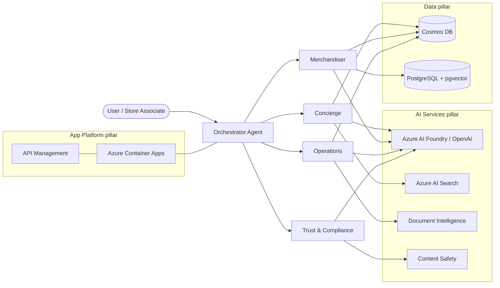

# Zava AI MicroHack — Build Enterprise AI Agents on Microsoft Azure

> A **1-day, instructor-led, Train-the-Trainer** microhack that teaches partners to design, build,
> and govern a multi-agent AI application on **Microsoft Azure** — and produces **audit evidence**
> for the *AI Applications on Microsoft Azure* **Advanced Specialization (Module B)** along the way.

[](https://github.com/NikoMix/microhack-ai-apps/actions/workflows/ci.yml)
[](https://github.com/NikoMix/microhack-ai-apps/actions/workflows/codeql.yml)
[](LICENSE)

---

## 🎯 What you build

You are the platform team at **Zava**, a fictional *intelligent athletic apparel* retailer. Over one
day you build the **Zava AI Agent Platform**: a set of cooperating enterprise agents (customer
**concierge**, **merchandiser**, **operations**, and a **trust & compliance** agent) on
**Microsoft Agent Framework**, grounded on Zava data, deployed to Azure, observable, and governed.



**Modular inference:** every AI call runs on **GitHub Models** (free, default), **Azure OpenAI**, or
**Azure AI Foundry** — switched by a single environment variable. Early labs cost **$0**; later labs
`azd up` into a real Azure subscription.

## 🧑‍🏫 Two tracks, one story

| Track | Stack |
|---|---|
| 🐍 **Python** | FastAPI + `agent-framework` (Microsoft Agent Framework) |
| 🟦 **.NET (C#)** | ASP.NET Minimal API + `Microsoft.Agents.AI` (Microsoft Agent Framework) |

Pick a track — both implement the **same agents, the same HTTP API, and the same labs**.

## 🗺️ The 1-day agenda

See **[docs/agenda.md](docs/agenda.md)**. Labs:

| Lab | Title | Module B focus | Pillar |
|---|---|---|---|
| 0 | Environment & GitHub Models | — | — |
| 1 | Your first Zava agent (modular inference) | B.1.1 | AI |
| 2 | Ground it: RAG with AI Search + pgvector | B.1.1 | AI + Data |
| 3 | Deploy to Azure: Container Apps via `azd` | B.1.1 | App Platform |
| 4 | Data agents: Cosmos DB catalog & orders | B.1.1 | Data |
| 5 | Trust, safety & observability | B.4.1 | AI |
| 6 | Capstone: GitHub agents, skills & MCP + evidence pack | B.1.1–B.4.2 | All |

## 🤖 GitHub agents, skills & MCP

This repo ships **GitHub Copilot custom agents**, **skills**, and **MCP servers** (including a custom
**Zava MCP server**) so learners extend the platform *with* AI. See [`.github/agents/`](.github/agents),
[`.github/skills/`](.github/skills), and [`mcp.json`](mcp.json).

## 🏅 Module B / Advanced Specialization mapping

Every lab output is also **audit evidence**. See **[docs/module-b-mapping.md](docs/module-b-mapping.md)**
and **[docs/cert-crosswalk.md](docs/cert-crosswalk.md)**. Source controls:
[NikoMix/specialization-ai-apps](https://github.com/NikoMix/specialization-ai-apps).

## 🚀 Quick start

```bash
# 1. Open in the dev container (VS Code: "Reopen in Container") — Python, .NET, azd, Bicep preinstalled
# 2. Run an agent on GitHub Models (free):
export GITHUB_TOKEN=<your PAT with models:read>
#   Python:
cd src/python && make run
#   .NET:
cd src/dotnet && dotnet run
# 3. Later labs — provision Azure:
azd up
```

## 📁 Repository structure

| Path | Contents |
|---|---|
| `docs/` | Overview, agenda, architecture, facilitator guide, labs, solutions, evidence templates |
| `slides/` | Marp decks (export to HTML/PDF/PPTX) |
| `src/python` · `src/dotnet` | The two reference tracks |
| `src/mcp-zava` | Custom Zava MCP server |
| `infra/` · `azure.yaml` | azd + Bicep (Azure Verified Modules) |
| `data/` | Zava seed data |
| `.github/` | Copilot agents, skills, instructions, workflows |
| `.microhack/build-contract.md` | The internal build specification |

## 👩‍🏫 For trainers

Start with the **[Facilitator Guide](docs/facilitator-guide/)** — timing, talk tracks, "how to teach
this", common pitfalls, and reset/troubleshooting steps.

## 📄 License

[MIT](LICENSE). Built with open-source tooling only — no paid licenses required.
