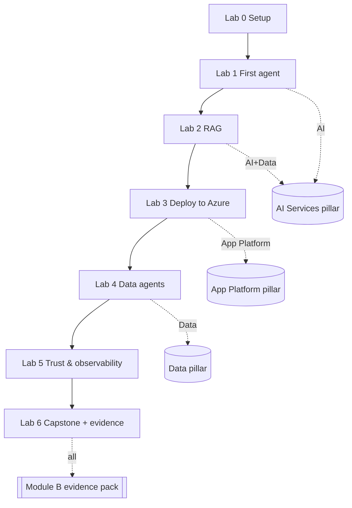

# Agenda — 1 day (Train-the-Trainer)

**Format:** instructor-led classroom with hands-on labs. **Audience:** partner engineers (delivered
as Train-the-Trainer, so trainers can re-deliver it). **Duration:** ~7.5 hours incl. breaks.
**Pre-reqs:** laptop, GitHub account (Copilot enabled), optional Azure subscription for Labs 3+.

| Time | Block | Type | Module B |
|---|---|---|---|
| 08:30 | **Welcome & TTT orientation** — how to teach this course, audience calibration | Trainer | — |
| 08:45 | **Why AI Apps on Azure** — the Advanced Specialization, the 3 ACR pillars, the Zava story | Lecture | B.2.1, B.2.2 |
| 09:10 | **Lab 0 — Environment & GitHub Models** — dev container, token, first inference call | Lab | — |
| 09:30 | **Agentic foundations** — Microsoft Agent Framework, agents vs workflows, modular inference | Lecture | B.1.1 |
| 09:50 | **Lab 1 — Your first Zava agent** — `concierge` on GitHub Models, tools, the HTTP API | Lab | B.1.1 |
| 10:40 | ☕ Break | — | — |
| 10:55 | **Grounding & RAG** — embeddings, AI Search, pgvector, citations | Lecture | B.1.1 |
| 11:10 | **Lab 2 — Ground it** — RAG over Zava policies & catalog; swap provider to Azure | Lab | B.1.1 |
| 12:00 | 🍽️ Lunch | — | — |
| 12:45 | **Azure platform** — azd, Bicep/AVM, Container Apps, managed identity, the 3 pillars in IaC | Lecture | B.2.1 |
| 13:05 | **Lab 3 — Deploy to Azure** — `azd up`, Container Apps, Foundry/AOAI, App Insights | Lab | B.1.1, B.2.1 |
| 14:00 | **Data agents** — Cosmos DB (catalog/orders) + PostgreSQL; data-grounded tools | Lecture | B.2.1 |
| 14:15 | **Lab 4 — Data agents** — `merchandiser` & `operations` over Cosmos + Postgres | Lab | B.1.1, B.2.1 |
| 15:00 | ☕ Break | — | — |
| 15:15 | **Trust, safety & governance** — Content Safety, OpenTelemetry, evaluations, OWASP for agents | Lecture | B.4.1 |
| 15:30 | **Lab 5 — Trust & observability** — `trust` agent, safety gate, tracing, evals | Lab | B.4.1 |
| 16:15 | **Build with AI** — GitHub Copilot custom agents, skills, MCP servers | Lecture | B.1.1 |
| 16:30 | **Lab 6 — Capstone** — extend Zava with a Copilot agent + Zava MCP; auto-generate the evidence pack | Lab | B.1.1–B.4.2 |
| 17:15 | **Evidence review & audit readiness** — package, index, customer diversity, cert crosswalk | Lecture | B.2.2, B.3.1, B.4.1, B.4.2 |
| 17:30 | **TTT debrief & close** — delivery tips, pitfalls, re-delivery checklist | Trainer | — |

## Lab ↔ pillar ↔ control at a glance

## Timing notes for trainers

- **Labs are the spine** (~3h45 of hands-on). Lectures are short framing slots — keep them tight.
- If you are **short on time**, Labs 0–3 are the minimum viable path; Labs 4–6 can be demoed.
- If the room has **no Azure**, run entirely on GitHub Models and *demo* Labs 3–4 from the trainer's
  subscription — the modular inference design makes this seamless.

See the [Facilitator Guide](facilitator-guide/index.md) for per-lab talk tracks and troubleshooting.
