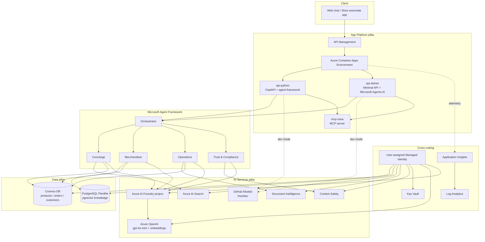
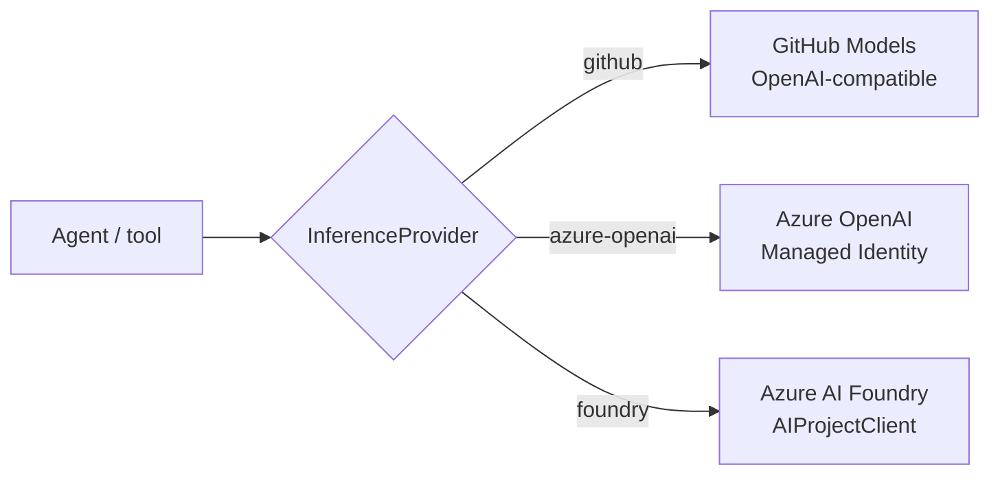
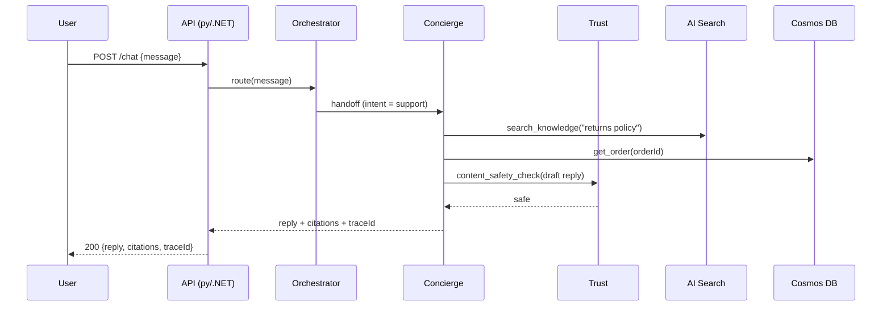

# Architecture

The Zava AI Agent Platform is a cloud-native, multi-agent system. It is intentionally designed to
exercise **all three Advanced Specialization ACR pillars** while following Azure Well-Architected and
AI-app best practices (managed identity everywhere, no keys, OpenTelemetry, IaC with azd + Bicep AVM).

## Logical architecture

## Modular inference

A single factory resolves chat + embedding clients from `INFERENCE_PROVIDER` /
`EMBEDDINGS_PROVIDER`. Agents are written once against the framework's chat-client abstraction, so
the provider swap is invisible to agent logic. Default `github` keeps Labs 0–2 free.

## Request flow (a customer asks about a return)

## Pillar → service mapping (drives ACR — B.2.1)

| Pillar | Azure services in this build |
|---|---|
| **AI Services** | Azure AI Foundry, Azure OpenAI, Azure AI Search, Document Intelligence, Content Safety |
| **App Platform** | Azure Container Apps, Azure Container Registry, API Management, GitHub + Copilot |
| **Data** | Azure Cosmos DB, Azure Database for PostgreSQL (pgvector) |

## Security & operations baseline

- **Identity:** one user-assigned **Managed Identity**; **DefaultAzureCredential** in code; **no keys**.
- **Secrets:** **Key Vault** (purge protection on); local dev via git-ignored `.env`.
- **Network/data:** Cosmos & Storage key-auth disabled; ACR anonymous pull disabled.
- **Observability:** OpenTelemetry traces/metrics/logs → **Application Insights**; every API
  response carries a `traceId`.
- **IaC:** **azd + Bicep (Azure Verified Modules)**, latest API versions, validated with
  `azd provision --preview`.

This page is also the basis for the **B.1.1 architecture-diagram** evidence artifact (see
`docs/evidence-templates/`).
