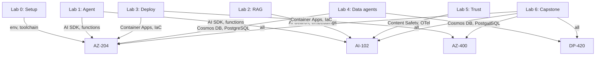

<!-- markdownlint-disable MD013 -->
# Certification Crosswalk — AZ-204, AZ-400, AI-102, DP-420

> **Control:** B.3.1 Certifications
> **What auditors check:** Five individuals at the partner organisation hold at least one of the
> required certifications: AZ-204 (Azure Developer Associate), AZ-400 (DevOps Engineer Expert),
> AI-102 (AI Engineer Associate), or DP-420 (Cosmos DB Developer Specialty). Each lab in this
> microhack maps to specific exam objectives so your study time serves double duty.

---

## How labs map to exam objectives

---

## AZ-204 — Azure Developer Associate

**Exam link:** [Learn: AZ-204](https://learn.microsoft.com/certifications/azure-developer/)

### Lab ↔ AZ-204 objective mapping

| Lab | Skill area | AZ-204 objective |
|-----|-----------|-----------------|
| Lab 0 | Dev environment | Set up development environment |
| Lab 1 | Agent / AI SDK | Implement solutions that use Azure AI services |
| Lab 1 | HTTP API | Develop Azure compute solutions (Container Apps) |
| Lab 2 | Vector search | Integrate Azure AI Search |
| Lab 3 | azd + Container Apps | Deploy containerised solutions using Container Apps |
| Lab 3 | Managed Identity | Implement authentication and authorisation |
| Lab 3 | Key Vault | Implement secure cloud solutions |
| Lab 4 | Cosmos DB | Develop solutions that use Azure Cosmos DB |
| Lab 4 | PostgreSQL | Develop solutions that use Azure SQL and relational databases |
| Lab 5 | Application Insights | Monitor and troubleshoot Azure solutions |
| Lab 5 | OpenTelemetry | Instrument solutions with Application Insights |
| Lab 6 | Full platform | Integrate caching and message-based solutions |

### Key AZ-204 study topics from this microhack

- **Container Apps:** deploying with `azd deploy`, environment variables, ingress configuration.
- **Managed Identity:** `DefaultAzureCredential`, user-assigned MI, role assignments.
- **Key Vault:** secret lifecycle, purge protection, Key Vault references in Container Apps.
- **Cosmos DB:** document model, partition key design, RBAC (key-auth disabled).
- **Application Insights:** connection string, SDK, `traceId` propagation.

---

## AZ-400 — Azure DevOps Engineer Expert

**Exam link:** [Learn: AZ-400](https://learn.microsoft.com/certifications/devops-engineer/)

### Lab ↔ AZ-400 objective mapping

| Lab | Skill area | AZ-400 objective |
|-----|-----------|-----------------|
| Lab 0 | Dev container | Configure processes and communications |
| Lab 3 | Bicep / AVM IaC | Design and implement an infrastructure strategy |
| Lab 3 | `azd provision` | Implement an infrastructure as code (IaC) strategy |
| Lab 3 | Container Registry | Manage containers in a DevOps pipeline |
| Lab 5 | Alerting | Design and implement process for routing/feedback of system feedback |
| Lab 6 | CI/CD (GitHub Actions) | Design and implement pipelines |
| Lab 6 | Dependency management | Design and implement a dependency management strategy |
| Lab 6 | Security scanning | Implement security in a pipeline |

### Key AZ-400 study topics from this microhack

- **Bicep AVM:** parameterisation, module composition, `azd provision --preview`.
- **Container image pipeline:** `azd deploy` builds and pushes with MI auth (no username/password).
- **Dependabot:** `.github/dependabot.yml` keeps dependencies current (zero vulnerabilities gate).
- **GitHub Actions workflows:** CI lint + build + audit; `markdownlint`, `ruff`, `dotnet format`.

---

## AI-102 — Azure AI Engineer Associate

**Exam link:** [Learn: AI-102](https://learn.microsoft.com/certifications/azure-ai-engineer/)

### Lab ↔ AI-102 objective mapping

| Lab | Skill area | AI-102 objective |
|-----|-----------|-----------------|
| Lab 1 | Azure AI Foundry + Agent Framework | Plan and manage Azure AI solutions |
| Lab 1 | Modular inference (`INFERENCE_PROVIDER`) | Implement and manage Azure OpenAI Service |
| Lab 2 | AI Search + embeddings | Implement knowledge mining and document intelligence |
| Lab 2 | pgvector (1536-dim) | Plan and implement AI Search solution |
| Lab 3 | Foundry project | Create and manage Azure AI Foundry hubs and projects |
| Lab 4 | Document Intelligence | Implement document intelligence solutions |
| Lab 5 | Content Safety | Implement content moderation solutions |
| Lab 5 | OpenTelemetry | Monitor AI solutions |
| Lab 6 | MCP + custom agents | Implement agentic AI solutions |
| Lab 6 | `generate_evidence` | Implement responsible AI |

### Key AI-102 study topics from this microhack

- **Azure AI Foundry:** hub + project structure, `AIProjectClient`, model deployments.
- **Azure OpenAI:** `gpt-4o-mini` for chat, `text-embedding-3-small` for embeddings (1536-dim).
- **Azure AI Search:** vector index creation, HNSW algorithm, 1536-dim field.
- **Document Intelligence:** prebuilt invoice model, structured field extraction.
- **Content Safety:** categories (hate, self-harm, sexual, violence), severity thresholds.
- **Responsible AI:** content safety gate pattern, OWASP LLM Top 10 mitigations.

---

## DP-420 — Cosmos DB Developer Specialty

**Exam link:** [Learn: DP-420](https://learn.microsoft.com/certifications/cosmos-db-developer-specialty/)

### Lab ↔ DP-420 objective mapping

| Lab | Skill area | DP-420 objective |
|-----|-----------|-----------------|
| Lab 3 | Cosmos DB provisioning | Design and implement data models |
| Lab 4 | Cosmos DB containers | Design data partitioning strategy |
| Lab 4 | Cosmos DB RBAC | Implement security |
| Lab 4 | Cosmos DB queries | Query data with SQL API |
| Lab 4 | Change feed / triggers | Implement Azure Cosmos DB solutions |
| Lab 5 | Cosmos DB tracing | Monitor and troubleshoot |
| Lab 6 | Seed data consistency | Maintain data integrity |

### Cosmos DB design decisions in this microhack

| Container | Partition key | Rationale |
|-----------|--------------|-----------|
| `products` | `/category` | Products queried by category; even distribution |
| `orders` | `/customerId` | Orders always queried by customer; per-customer isolation |
| `customers` | `/id` | Small static container; `/id` avoids hot partition |

### Key DP-420 study topics from this microhack

- **Partition key design:** balance read/write patterns; avoid hot partitions.
- **RBAC:** `disableLocalAuth: true`; `Cosmos DB Built-in Data Contributor` role.
- **SQL API queries:** `SELECT TOP 3 c.id, c.name FROM c WHERE c.category = "running"`.
- **Consistency levels:** the microhack uses `Session` consistency (good default for agent workloads).
- **Request Units (RUs):** serverless tier used in lab; production uses provisioned throughput.

---

## 5-Person Study Plan (B.3.1)

To meet B.3.1 you need **5 certified individuals**, each with at least one qualifying cert.
The recommended team composition for an AI Agent Platform practice:

| Person | Role | Recommended certification | Why |
|--------|------|--------------------------|-----|
| 1 | **AI Engineer** | AI-102 | Direct alignment with AI Foundry, AI Search, Content Safety |
| 2 | **Cloud Developer** | AZ-204 | Owns the application code, Container Apps, Key Vault |
| 3 | **DevOps Engineer** | AZ-400 | CI/CD pipelines, IaC with Bicep, security scanning |
| 4 | **Data Engineer** | DP-420 | Cosmos DB data model, pgvector integration |
| 5 | **Solution Architect** | AI-102 _or_ AZ-204 | Can cover either; AI-102 preferred for AI specialization |

### Study path by role (lab-first approach)

| Week | Activity | Covers |
|------|---------|--------|
| 1 | Labs 0–2 (self-paced, GitHub Models only) | Dev environment, agents, RAG |
| 2 | Labs 3–4 (Azure subscription required) | Deployment, data agents |
| 3 | Labs 5–6 + evidence templates | Trust, observability, evidence |
| 4 | Microsoft Learn paths for target cert | Exam-specific objectives |
| 5 | Practice tests + review weak areas | Exam readiness |
| 6 | Sit exam | Certification |

### Microsoft Learn paths aligned to each lab

| Lab | AI-102 path | AZ-204 path | AZ-400 path | DP-420 path |
|-----|------------|------------|------------|------------|
| Lab 1 | [Get started with Azure AI Foundry](https://learn.microsoft.com/training/paths/azure-ai-foundry-get-started/) | [Develop AI solutions with Azure OpenAI](https://learn.microsoft.com/training/paths/develop-ai-solutions-azure-openai/) | — | — |
| Lab 2 | [Implement knowledge mining with Azure AI Search](https://learn.microsoft.com/training/paths/implement-knowledge-mining-azure-cognitive-search/) | [Develop solutions with Azure AI Search](https://learn.microsoft.com/training/paths/implement-knowledge-mining-azure-cognitive-search/) | — | — |
| Lab 3 | — | [Deploy containerised solutions](https://learn.microsoft.com/training/paths/az-204-implement-iaas-solutions/) | [Design and implement an IaC strategy](https://learn.microsoft.com/training/paths/az-400-manage-infrastructure-resources-azure/) | — |
| Lab 4 | — | [Develop solutions with Cosmos DB](https://learn.microsoft.com/training/paths/az-204-develop-solutions-that-use-azure-cosmos-db/) | — | [Work with Azure Cosmos DB](https://learn.microsoft.com/training/paths/dp-420-implement-azure-cosmos-db-sql-api/) |
| Lab 5 | [Implement content moderation](https://learn.microsoft.com/training/paths/create-computer-vision-solutions-azure-ai/) | [Instrument solutions with App Insights](https://learn.microsoft.com/training/paths/az-204-instrument-solutions-support-monitoring-logging/) | [Design process for feedback](https://learn.microsoft.com/training/paths/az-400-facilitate-communication-collaboration/) | — |
| Lab 6 | [Build generative AI solutions](https://learn.microsoft.com/training/paths/create-custom-copilots-ai-studio/) | — | [Implement a secure pipeline](https://learn.microsoft.com/training/paths/az-400-implement-security-validate-code-base-compliance/) | — |

---

## Evidence submission for B.3.1

Attach the following to your Module B submission:

| Person | Full name | Certification | Cert number | Exam date |
|--------|-----------|--------------|-------------|-----------|
| 1 | `[PLACEHOLDER]` | AI-102 | `[PLACEHOLDER]` | `[PLACEHOLDER]` |
| 2 | `[PLACEHOLDER]` | AZ-204 | `[PLACEHOLDER]` | `[PLACEHOLDER]` |
| 3 | `[PLACEHOLDER]` | AZ-400 | `[PLACEHOLDER]` | `[PLACEHOLDER]` |
| 4 | `[PLACEHOLDER]` | DP-420 | `[PLACEHOLDER]` | `[PLACEHOLDER]` |
| 5 | `[PLACEHOLDER]` | `[PLACEHOLDER]` | `[PLACEHOLDER]` | `[PLACEHOLDER]` |

Verifiable via [Microsoft Learn transcript](https://learn.microsoft.com/users/) — auditors will
spot-check against the public transcript URL.

> **Tip:** Certifications must be current (not expired) at the time of audit. AZ-204, AZ-400,
> and AI-102 renew annually for free via the online renewal assessment on Microsoft Learn.
> DP-420 does not currently have a renewal assessment — retake the exam before expiry.
