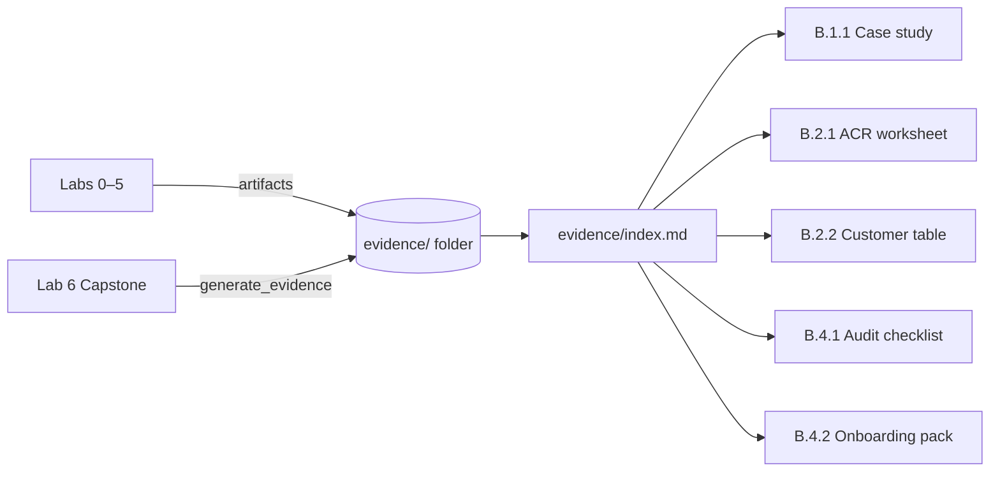

# Evidence Templates — Module B

This folder contains **fill-in-ready templates** for every control in the
_AI Applications on Microsoft Azure_ Advanced Specialization (Module B).

## How the evidence system works

The `trust` agent's `generate_evidence` tool auto-populates **draft** versions of these
templates from lab outputs. You review, complete, and export them as the final audit package.

## Template files

| File | Control | What it is |
|------|---------|-----------|
| [b11-capability-case-study.md](b11-capability-case-study.md) | B.1.1 | Case study + architecture diagram placeholder + capability statement |
| [b21-acr-pillar-worksheet.md](b21-acr-pillar-worksheet.md) | B.2.1 | ACR pillar worksheet + Partner Center export walkthrough |
| [b22-customer-diversity.md](b22-customer-diversity.md) | B.2.2 | Customer diversity table + DPOR/PAL/CSP explainer |
| [b41-evidence-index.md](b41-evidence-index.md) | B.4.1 | Evidence index + pre-audit checklist |
| [b42-onboarding-pack.md](b42-onboarding-pack.md) | B.4.2 | Partner onboarding pack + delivery templates |

## Workflow

### During the microhack (labs)

1. At each **"Evidence checkpoint"** in the student labs, save the named artifact(s).
2. Use the folder naming convention: `evidence/b<control>-<description>-lab<n>.<ext>`.
3. Run `generate_evidence` at the end of Lab 5 to create draft templates.

### After the microhack

1. Open each template below and replace every `[PLACEHOLDER]` with real data.
2. Export the filled templates and artifacts as a zip archive.
3. Upload to your Partner Center evidence library.

## Fields marked `[PLACEHOLDER]`

Every template uses `[PLACEHOLDER: description]` for fields that require real data from your
organisation. Do not leave placeholders in the final submission.

## What `generate_evidence` populates automatically

| Field | Populated automatically |
|-------|------------------------|
| Architecture diagram | Mermaid from `docs/architecture.md` |
| Azure services list | From `az resource list` output |
| Agent list | From `GET /agents` response |
| Evidence artifact list | Scanned from `evidence/` folder |
| traceId examples | From lab `/chat` responses |
| Business units | From `data/customers.json` |

## What you must fill in manually

- Partner organisation name and contact details
- Real customer names and association types (DPOR/PAL/CSP)
- ACR revenue figures per pillar
- Certified individuals' names and certification dates
- Project dates and actual business outcomes
