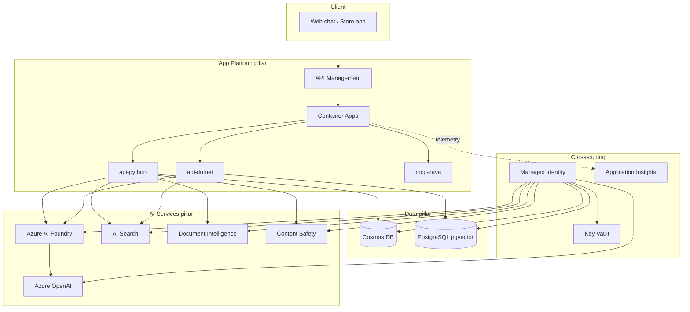

# B.1.1 — Azure AI Implementation: Capability Case Study

> **Control:** B.1.1 Azure AI Implementation
> **What auditors check:** Demonstrated technical capability delivering AI solutions on Azure.
> **Evidence required:** Case study, architecture diagram, capability statement, sample deliverables.

---

## Part 1 — Capability Statement

> _Fill in your organisation's details. Keep to ≤ 300 words._

**Partner organisation:** `[PLACEHOLDER: Your company name]`

**Contact:** `[PLACEHOLDER: Name, Title, Email]`

**Specialization sought:** AI Applications on Microsoft Azure

**Date of submission:** `[PLACEHOLDER: YYYY-MM-DD]`

### Capability summary

`[PLACEHOLDER: 2–3 sentences describing your organisation's AI practice. Example:]`

> [Partner name] is a Microsoft Partner with an established AI engineering practice delivering
> enterprise AI solutions on Azure. Our team has designed and deployed multi-agent AI platforms
> for customers across retail, manufacturing, and financial services sectors, using the Microsoft
> Agent Framework, Azure AI Foundry, and Azure OpenAI.

### Solution built in this microhack

We built the **Zava AI Agent Platform** — a production-grade, multi-agent AI system that
demonstrates the full breadth of Azure AI capability:

| Capability | Azure service | Evidence |
|-----------|--------------|---------|
| Generative AI / LLM inference | Azure AI Foundry + Azure OpenAI (gpt-4o-mini) | Lab 1 transcript |
| Retrieval-Augmented Generation | Azure AI Search + PostgreSQL pgvector (1536-dim) | Lab 2 citations |
| Document understanding | Azure AI Document Intelligence | Lab 4 supplier parsing |
| Content safety & governance | Azure AI Content Safety | Lab 5 safety gate |
| Agent orchestration | Microsoft Agent Framework | Labs 1–6 |
| Observability | OpenTelemetry → Application Insights | Lab 5 trace waterfall |
| IaC & deployment | azd + Bicep AVM → Container Apps | Lab 3 deployment |

---

## Part 2 — Architecture Diagram

> _Paste or embed your architecture diagram here. The MkDocs site renders Mermaid directly._

> **Facilitator note:** For a real submission, replace this diagram with an exported PNG from
> the Azure Portal's architecture view, or a draw.io diagram based on the deployed resource group.
>
> **Placeholder for architecture diagram image:**
> `[PLACEHOLDER: Insert architecture-diagram.png exported from Azure Portal or draw.io]`

---

## Part 3 — Azure AI Case Study

### Customer / scenario

**Customer name:** `[PLACEHOLDER: Real customer name, or "Zava (scenario)" for training]`

**Industry:** `[PLACEHOLDER: Retail / Manufacturing / Financial Services / etc.]`

**Project duration:** `[PLACEHOLDER: e.g. 3 months — YYYY-MM to YYYY-MM]`

**Azure region(s):** `[PLACEHOLDER: e.g. East US, UK South]`

### Business challenge

`[PLACEHOLDER: 1–2 paragraphs describing the customer's business problem.]`

**Example (Zava scenario):**

> Zava's three business units (Retail Stores, eCommerce, Wholesale) needed fast, grounded,
> trustworthy answers about orders, products, inventory, and policies. Existing channels were
> siloed, slow, and could not scale to the volume of associate and customer enquiries.

### Solution architecture

`[PLACEHOLDER: Describe the solution you built. Reference the architecture diagram above.]`

**Example (Zava scenario):**

> We built a multi-agent AI platform on the **Microsoft Agent Framework** deployed to
> **Azure Container Apps**. The platform routes each request through an **Orchestrator** to
> specialist agents (Concierge, Merchandiser, Operations, Trust). Responses are grounded via
> **RAG** (Azure AI Search + PostgreSQL pgvector with 1536-dim embeddings) and validated by a
> **Content Safety** gate before delivery. All services authenticate via **Managed Identity**;
> secrets live in **Key Vault**; telemetry flows through **OpenTelemetry → Application Insights**.

### Azure services consumed

`[PLACEHOLDER: List Azure services with SKU/tier and estimated monthly spend.]`

| Service | SKU / Tier | Pillar |
|---------|-----------|--------|
| Azure AI Foundry | Standard | AI Services |
| Azure OpenAI (gpt-4o-mini) | Standard | AI Services |
| Azure OpenAI (text-embedding-3-small) | Standard | AI Services |
| Azure AI Search | Standard S1 | AI Services |
| Azure Document Intelligence | Standard | AI Services |
| Azure AI Content Safety | Standard | AI Services |
| Azure Container Apps | Consumption | App Platform |
| Azure Container Registry | Basic | App Platform |
| Azure API Management | Developer/Standard | App Platform |
| Azure Cosmos DB | Serverless | Data |
| Azure Database for PostgreSQL | Flexible / Burstable | Data |
| Azure Key Vault | Standard | Cross-cutting |
| Azure Monitor / App Insights | Workspace-based | Cross-cutting |

### Business outcomes

`[PLACEHOLDER: Quantified outcomes. Examples:]`

| Business unit | Outcome |
|--------------|---------|
| `[PLACEHOLDER]` | `[PLACEHOLDER: e.g. 3× faster query resolution]` |
| `[PLACEHOLDER]` | `[PLACEHOLDER: e.g. 80% reduction in manual invoice processing]` |
| `[PLACEHOLDER]` | `[PLACEHOLDER: e.g. 15% uplift in average order value]` |

**Example (Zava scenario):**

| Business unit | Outcome |
|--------------|---------|
| Retail Stores | Store associates resolve product and returns queries 3× faster |
| eCommerce | Personalised recommendations increase average order value by 15% |
| Wholesale | Automated supplier doc parsing reduces invoice processing time by 80% |

### Technical proof points

- **Modular inference**: solution runs on GitHub Models (free) → Azure OpenAI → Azure AI Foundry
  via a single `INFERENCE_PROVIDER` env var. No provider lock-in.
- **Security**: `DefaultAzureCredential` throughout; zero hardcoded keys; Cosmos DB key-auth
  disabled; Key Vault purge protection enabled; ACR anonymous pull disabled.
- **Observability**: every `/chat` response carries a `traceId`; full distributed trace visible
  in Application Insights including AI Search, Cosmos DB, and Content Safety spans.
- **IaC**: entire infrastructure deployed via `azd up` with Bicep / Azure Verified Modules.

---

## Part 4 — Sample Deliverables Checklist

Attach the following to this evidence package:

- [ ] Architecture diagram (PNG or PDF)
- [ ] `evidence/b11-agent-transcript-lab1.txt`
- [ ] `evidence/b11-rag-citations-lab2.png`
- [ ] `evidence/b11-appi-trace-lab3.png`
- [ ] `evidence/b11-appi-waterfall-lab5.png`
- [ ] `az resource list` output (all deployed services)
- [ ] GitHub repository URL: `https://github.com/[PLACEHOLDER: your-org/your-repo]`

---

> **Next:** Complete [B.2.1 ACR Pillar Worksheet](b21-acr-pillar-worksheet.md)
