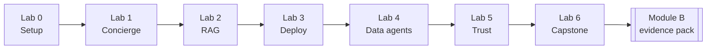

# Zava AI MicroHack — Student Labs

Seven progressive hands-on labs that build a complete multi-agent AI platform for **Zava**, an
intelligent athletic apparel company. By the end you will have built a production-grade system on
Microsoft Azure and assembled the Module B audit evidence for the
_AI Applications on Microsoft Azure_ Advanced Specialization.

## Lab overview

| Lab | Title | Est. time | Module B controls |
|-----|-------|----------:|-------------------|
| [Lab 0](lab0.md) | Environment & GitHub Models | 20 min | B.3.1 |
| [Lab 1](lab1.md) | Your first Zava agent (Concierge) | 50 min | B.1.1, B.3.1 |
| [Lab 2](lab2.md) | Ground it — RAG over Zava knowledge | 50 min | B.1.1, B.2.1, B.3.1 |
| [Lab 3](lab3.md) | Deploy to Azure with azd | 55 min | B.1.1, B.2.1, B.3.1, B.4.2 |
| [Lab 4](lab4.md) | Data agents: Merchandiser & Operations | 45 min | B.1.1, B.2.1, B.2.2, B.3.1 |
| [Lab 5](lab5.md) | Trust, safety & observability | 45 min | B.1.1, B.3.1, B.4.1 |
| [Lab 6](lab6.md) | Capstone — Extend Zava & generate evidence | 45 min | B.1.1–B.4.2 |

**Total hands-on time:** ~310 min (~5 h 10 min across the day, interleaved with lectures).

## What you build

## How to use these labs

- **Self-paced:** work through each lab sequentially.
- **Instructor-led:** your trainer will frame each lab with a short lecture; labs have clear
  **start** and **stop** markers.
- **No Azure required for Labs 0–2:** they run entirely on GitHub Models (free). Azure is
  needed from Lab 3 onward (or the trainer demos Labs 3–4).
- **Both tracks covered:** each lab shows Python _and_ .NET commands side-by-side where they
  differ. The HTTP API and behavior are identical.

## Prerequisites

- GitHub account with Copilot enabled
- A GitHub Personal Access Token with `models:read` scope
- Docker Desktop (for the dev container) **or** a Codespace
- Azure subscription (optional until Lab 3)

## Quick links

- [Build Contract](../../.microhack/build-contract.md) — authoritative specification
- [Architecture](../architecture.md) — system design
- [Module B Mapping](../module-b-mapping.md) — lab ↔ control crosswalk
- [Solutions / answer keys](../solutions/index.md) — facilitator only
- [Evidence templates](../evidence-templates/README.md)
- [Cert crosswalk](../cert-crosswalk.md) — AZ-204, AZ-400, AI-102, DP-420
