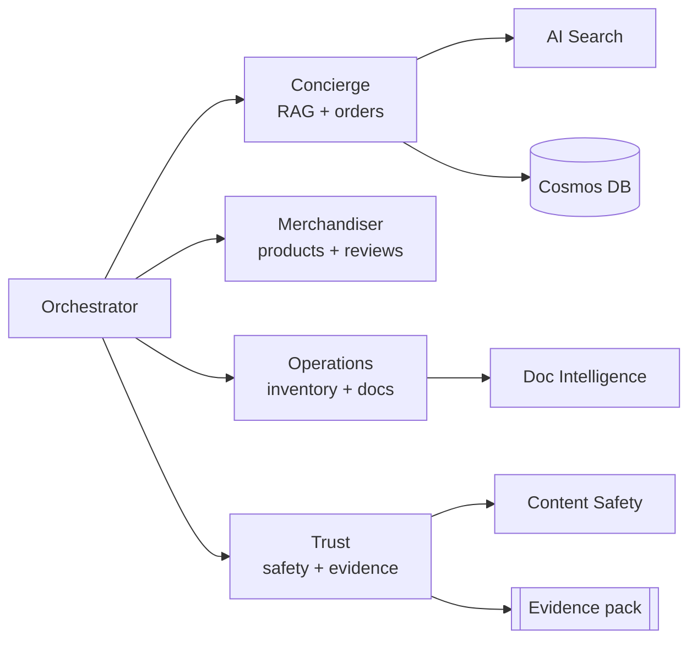

# Lab 6 — Capstone: Extend Zava & Generate Evidence

> **Estimated time:** 45 minutes
> **Module B controls:** B.1.1, B.2.1, B.2.2, B.3.1, B.4.1, B.4.2 (all controls)

## Learning objectives

By the end of this lab you will be able to:

1. Build a custom GitHub Copilot agent that integrates with the Zava MCP server.
2. Extend the Zava MCP server with a new tool.
3. Run the `trust` agent's `generate_evidence` end-to-end to produce the full Module B evidence
   package.
4. Review and validate the evidence package against all B.1.1–B.4.2 controls.
5. Export the evidence index and artifact bundle.

## Prerequisites

- Labs 1–5 complete.
- `evidence/index.md` created by Lab 5's `generate_evidence` call.

---

## Part A — Extend Zava with a GitHub Copilot custom agent

### Step A1 — Understand the Zava MCP server

The `src/mcp-zava` directory contains the custom **Zava MCP server** — a
[Model Context Protocol](https://modelcontextprotocol.io/) server that exposes Zava tools to
GitHub Copilot (and to the agents via the `mcp.json` integration).

The MCP server already exposes tools for products, orders, and knowledge. In this step you will
add a new tool.

```bash
# Explore the existing MCP server tools
cat src/mcp-zava/src/tools.ts       # (or equivalent for your track)
cat mcp.json                         # VS Code MCP server config
```

### Step A2 — Add a sustainability_score tool

Add a new tool to the MCP server that calculates a sustainability score for a product:

=== "Node.js (mcp-zava)"

    Edit `src/mcp-zava/src/tools.ts` and add:

    ```typescript
    export const sustainabilityScoreTool = {
      name: "get_sustainability_score",
      description: "Returns Zava's sustainability rating for a product based on materials and lifecycle.",
      inputSchema: {
        type: "object",
        properties: {
          productId: { type: "string", description: "The Zava product ID (e.g. ZP-001)" }
        },
        required: ["productId"]
      }
    };
    ```

    Implement the handler to look up the product from the catalog and return a mock score:

    ```typescript
    async function handleSustainabilityScore(productId: string) {
      const product = catalog.find(p => p.id === productId);
      if (!product) return { score: null, error: "Product not found" };
      // Score derived from smart features (recycled materials flag in product data)
      const score = product.smartFeatures?.includes("recycled") ? 85 : 65;
      return { productId, name: product.name, sustainabilityScore: score, rating: score >= 80 ? "Green" : "Amber" };
    }
    ```

### Step A3 — Start the MCP server and test the new tool

=== "Local"

    ```bash
    cd src/mcp-zava
    npm install
    npm run dev
    ```

    In a new terminal, test with the MCP inspector:

    ```bash
    npx @modelcontextprotocol/inspector http://localhost:3001
    ```

=== "Deployed (Container App)"

    ```bash
    azd deploy --service mcp-zava
    ```

### Step A4 — Create a GitHub Copilot custom agent

The `.github/agents/zava-advisor.md` file defines a Copilot custom agent. Review it:

```bash
cat .github/agents/zava-advisor.md
```

Open GitHub Copilot Chat in VS Code and invoke the agent:

```text
@zava-advisor What is the sustainability score for ZP-001?
```

The agent uses the Zava MCP server to retrieve the score — demonstrating the full
**GitHub Copilot → MCP server → Zava data** integration path.

---

## Part B — Generate the full Module B evidence package

### Step B1 — Run generate_evidence end-to-end

```bash
curl -s -X POST $PYTHON_URL/chat \
  -H "Content-Type: application/json" \
  -d '{
    "message": "Generate the complete Module B evidence package for controls B.1.1 through B.4.2.",
    "agent": "trust"
  }' | python -m json.tool
```

The `trust` agent's `generate_evidence` tool:

1. Scans the `evidence/` folder for artifacts created in Labs 0–5.
2. Maps each artifact to its Module B control.
3. Generates `evidence/index.md` — the evidence index.
4. Generates `evidence/b11-case-study.md` — a draft capability case study.
5. Generates `evidence/b41-checklist.md` — the pre-audit checklist.

### Step B2 — Review the evidence index

```bash
cat evidence/index.md
```

Expected structure:

```markdown
# Module B Evidence Index — Zava AI MicroHack

## B.1.1 Azure AI Implementation
- b11-agent-transcript-lab1.txt
- b11-rag-citations-lab2.png
- b11-appi-trace-lab3.png
- b11-appi-waterfall-lab5.png

## B.2.1 ACR Performance
- b21-resource-inventory-lab3.txt
- b21-pgvector-seed-lab2.txt
- b21-cosmos-trace-lab4.png

## B.2.2 Customer Diversity
- b22-business-unit-queries-lab4.txt

## B.3.1 Certifications
- b31-environment-screenshot.png

## B.4.1 Audit Readiness
- b41-appi-waterfall-lab5.png
- b41-checklist.md

## B.4.2 Partner Onboarding
- infra/ (Bicep AVM modules)
- docs/evidence-templates/b42-onboarding-pack.md
```

### Step B3 — Fill in the case study template

Open the generated draft:

```bash
cat evidence/b11-case-study.md
```

Fill in the placeholder fields:

- **Partner name** — your organisation.
- **Customer name** — Zava (the microhack scenario).
- **Project dates** — today's date.
- **Azure services used** — copy from `b21-resource-inventory-lab3.txt`.
- **Business outcomes** — describe what the platform achieves for each Zava business unit.

The filled case study is the primary **B.1.1** evidence artifact.

### Step B4 — Validate the pre-audit checklist

```bash
cat evidence/b41-checklist.md
```

Work through each item. Mark items complete as you verify them:

```markdown
- [x] Architecture diagram matches deployed resources
- [x] All services authenticated via Managed Identity (no keys)
- [x] Key Vault purge protection enabled
- [x] ACR anonymous pull disabled
- [x] Cosmos DB key-auth disabled
- [x] OpenTelemetry traces visible in Application Insights
- [ ] Partner Center export showing $15k ACR per pillar ← fill after the lecture
- [ ] 5 certified individuals mapped to exam objectives ← fill with real names
```

---

## Part C — Export the evidence bundle

### Step C1 — Archive the evidence folder

=== "Bash"

    ```bash
    tar -czf zava-evidence-$(date +%Y%m%d).tar.gz evidence/
    ls -lh zava-evidence-*.tar.gz
    ```

=== "PowerShell"

    ```powershell
    Compress-Archive -Path evidence/ -DestinationPath "zava-evidence-$(Get-Date -Format yyyyMMdd).zip"
    Get-Item zava-evidence-*.zip
    ```

### Step C2 — Commit the evidence index (but NOT raw screenshots)

```bash
git add evidence/index.md evidence/b11-case-study.md evidence/b41-checklist.md
git commit -m "feat(lab6): add Module B evidence index and case study template"
```

!!! warning "Do not commit sensitive data"
    Screenshots, invoices, and Partner Center exports may contain PII or confidential revenue
    data. Keep them in the `.tar.gz` / `.zip` bundle outside the repository.

---

## Validation checklist

- [ ] Sustainability score MCP tool returns a score for `ZP-001`.
- [ ] GitHub Copilot `@zava-advisor` agent responds using the MCP tool.
- [ ] `generate_evidence` produces `evidence/index.md` with entries for all six controls.
- [ ] `evidence/b11-case-study.md` draft contains all required fields.
- [ ] Pre-audit checklist has ≥ 6 items checked.
- [ ] Evidence archive created and named with today's date.

---

## Evidence checkpoint — B.1.1–B.4.2 (all controls)

| Artifact | What it proves | Control |
|----------|---------------|---------|
| `@zava-advisor` MCP integration demo | Custom agent + MCP server | B.1.1 |
| `evidence/index.md` | Structured evidence package | B.4.1 |
| `evidence/b11-case-study.md` (filled) | Azure AI capability statement | B.1.1 |
| `evidence/b41-checklist.md` | Pre-audit readiness checklist | B.4.1 |
| Infra Bicep modules (`infra/`) | Reusable IaC delivery template | B.4.2 |
| Three business-unit evidence | Customer diversity proof | B.2.2 |
| All three ACR pillar services documented | Pillar coverage for $15k target | B.2.1 |

---

## Congratulations

You have built a complete multi-agent AI platform on Microsoft Azure and generated a structured
Module B evidence package. Here is what you created:



## Next steps

- Review [evidence templates](../evidence-templates/README.md) to complete the full Module B
  submission.
- Study the [cert crosswalk](../cert-crosswalk.md) to map your lab work to exam objectives.
- Share the evidence bundle with your practice lead for a real audit submission.
